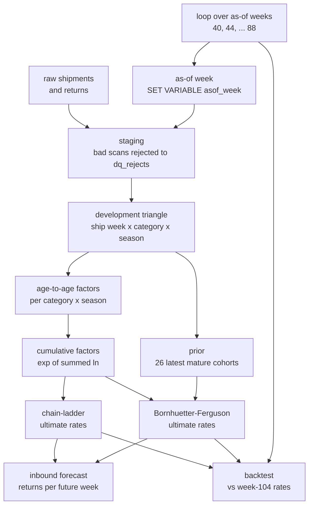

# returnlag

[](https://github.com/SlateGitOrg/returnlag/actions/workflows/ci.yml)


returnlag measures apparel return rates by shipment cohort and completes the young cohorts with two actuarial methods, chain-ladder and Bornhuetter-Ferguson, written as DuckDB SQL. The same SQL runs as of any earlier week, which makes every method backtestable: the choice between them is a measured error, not an opinion. The data is synthetic and generated at run time from a seed.

## The problem

An online apparel retailer with a free 60-day return policy reports each month's return rate as returns received divided by units shipped. Returns trickle in for up to 13 weeks, so the most recent months always look best. Merchandising credits a fix that did nothing, finance sets the refund reserve from incomplete numbers, and the returns centre staffs for the returns already received rather than the ones still on their way.

returnlag treats each ship week x category as a cohort, builds a development triangle of cumulative returns by weeks since shipment, and projects every cohort to its final return rate.

## How it works



Python generates the data, runs the SQL files in order (each one `CREATE OR REPLACE`s its tables), exposes the CLI and holds the tests. The analysis itself is in `sql/`:

| File | Table | What it does |
| --- | --- | --- |
| `10_stg_shipments.sql` | `stg_shipments` | Shipments dated on or before the as-of week; ship week index; `holiday` (ISO weeks 46-52) or `regular` segment. |
| `11_stg_returns.sql` | `stg_returns`, `dq_rejects` | Returns joined to their shipment. A return dated before its shipment, or with no shipment known at the as-of date, goes to `dq_rejects` with a reason. |
| `20_int_triangle.sql` | `int_triangle` | Cohort x development week 0..12: cumulative returned units and units shipped. Only cells observable at the as-of date exist. |
| `30_int_factors.sql` | `int_factors` | Volume-weighted age-to-age factors per category x segment; tail factor 1.0 after week 12. |
| `31_int_cdf.sql` | `int_cdf` | Cumulative development factor, `exp(sum(ln f))` over a window. |
| `32_int_factors_pooled.sql` | `int_factors_pooled`, `int_cdf_pooled` | The same with the season segment pooled away, for comparison. |
| `40_int_prior.sql` | `int_prior` | Bornhuetter-Ferguson prior: volume-weighted final rate of the 26 most recent cohorts aged 13 weeks or more, same category and segment. |
| `50_fct_ultimates.sql`, `51_fct_ultimates_pooled.sql` | `fct_ultimates`, `fct_ultimates_pooled` | Observed rate, chain-ladder ultimate (observed x CDF) and BF ultimate (observed + prior x (1 - 1/CDF)) per cohort. |
| `60_fct_inbound_forecast.sql` | `fct_inbound_forecast` | (ultimate - observed) spread over the weeks still to come by the incremental development pattern. |
| `70_mart_disposition.sql` | `mart_disposition`, `mart_net_return_cost` | Returns graded A (restock), B (outlet), C (liquidate) with recovery per grade; net return cost per category. Unit prices, handling costs and recovery shares are assumptions in `config.py`, loaded as `ref_grade` and `ref_category_economics`; only the counts and grades come from the data. |

`sql/tests/` holds queries that must return zero rows: cumulative returns never fall over development, every CDF is at least 1, no ultimate is below its observed rate, no return dated before shipment survives staging, plus range checks on development weeks, rejects and the forecast. `returnlag build` runs them after every build.

Disposition economics are assumptions. The data records a grade per return but no prices or costs. Unit prices, handling costs and the share of price recovered per grade (A 92 %, B 58 %, C 12 %) are parameters in `config.py`, loaded into reference tables before the models run. The net-cost table in the report scales with them and should be read as a worked example, not a measurement.

The as-of week is a DuckDB variable (`SET VARIABLE asof_week = 80`). Every model reads it through `getvariable`, so the same SQL produces the picture as it stood in any earlier week; `returnlag backtest` is a loop that sets the variable, rebuilds, and scores.

The synthetic data (`returnlag generate`) has 104 weekly ship cohorts from 2024-07-01, six categories and about 147,000 units shipped, of which about 33,000 come back. True ultimate rates are dresses 36 %, denim 24 %, footwear 22 %, tops 16 %, outerwear 14 % and accessories 6 %. Return lags come from a mixture of two discretised gamma distributions per category (most items are returned quickly, a minority near the end of the 60-day window; median 9 days for footwear, 14 for dresses, 18 for outerwear; about 3 % of regular-season returns after day 60, none after day 90) and are stretched by 1.8 for holiday-season cohorts. Three patterns are injected: a dresses size-guide fix from ship week 84 that lowers the dresses rate from 36 % to 29 %, 37 returns dated before their shipment (scanner clock errors), and a promotion in weeks 52-55 that doubles volume at unchanged rates.

## Quick start

```bash
python -m venv .venv && . .venv/bin/activate
pip install -e ".[dev]"

returnlag generate --seed 7 --out data     # synthetic shipments.csv, returns.csv, truth.json
returnlag build --as-of 104                # build every model, run sql/tests
returnlag backtest                         # rebuild as of weeks 40, 44, ..., 88 and score
returnlag inbound --as-of 104 --weeks 8    # expected returns arriving over the next 8 weeks
returnlag report --category dresses --category denim   # Markdown report in out/report.md
pytest -q
```

A small sample (the first 8 weeks, `returnlag generate --weeks 8`) is committed in `sample/`: `returnlag build --as-of 8 --data sample`. It is too short to backtest: `returnlag backtest` takes its final week from the data and stops with a message if the data covers fewer than 44 ship weeks.

## Example output

All numbers below come from running the commands above on the seeded data (`--seed 7`).

`returnlag backtest`: mean absolute error in percentage points against the rate each cohort reached by week 104, scoring cohorts aged 0-8 weeks at 13 as-of weeks.

```text
| method | aged 0-1 wk | aged 2-4 wk | aged 5-8 wk |
| :--- | ---: | ---: | ---: |
| naive (observed rate) | 14.64 | 7.85 | 3.19 |
| chain-ladder | 5.25 | 1.89 | 0.94 |
| Bornhuetter-Ferguson | 2.01 | 1.40 | 0.82 |
| chain-ladder, pooled factors | 6.24 | 2.01 | 1.41 |
| cohort-category scores per method | 156 | 234 | 312 |
```

Latest holiday season in the backtest (ship weeks 72-78), cohorts aged 1-6 weeks:

```text
| method | MAE (pp) | scores |
| :--- | ---: | ---: |
| chain-ladder, segmented factors | 1.79 | 60 |
| chain-ladder, pooled factors | 2.89 | 60 |
```

`returnlag report --category dresses --category denim`: the latest six cohorts as of week 104. The observed rate is what the monthly report would show.

```text
| category | ship week | week of | age | units | observed | chain-ladder | BF |
| :--- | ---: | :--- | ---: | ---: | ---: | ---: | ---: |
| denim | 99 | 2026-05-18 | 5 | 268 | 19.8% | 27.1% | 26.2% |
| denim | 100 | 2026-05-25 | 4 | 258 | 19.0% | 29.7% | 27.6% |
| denim | 101 | 2026-06-01 | 3 | 239 | 16.3% | 27.4% | 25.9% |
| denim | 102 | 2026-06-08 | 2 | 261 | 18.0% | 32.0% | 28.4% |
| denim | 103 | 2026-06-15 | 1 | 269 | 8.9% | 20.3% | 22.2% |
| denim | 104 | 2026-06-22 | 0 | 263 | 5.3% | 48.5% | 26.4% |
| dresses | 99 | 2026-05-18 | 5 | 374 | 17.6% | 24.9% | 27.6% |
| dresses | 100 | 2026-05-25 | 4 | 355 | 19.2% | 31.1% | 32.2% |
| dresses | 101 | 2026-06-01 | 3 | 350 | 16.9% | 29.6% | 31.5% |
| dresses | 102 | 2026-06-08 | 2 | 360 | 16.1% | 30.0% | 31.9% |
| dresses | 103 | 2026-06-15 | 1 | 377 | 10.3% | 25.3% | 30.4% |
| dresses | 104 | 2026-06-22 | 0 | 395 | 2.0% | 21.2% | 32.8% |
```

`returnlag inbound --as-of 104 --weeks 8`: units expected to arrive from cohorts already shipped.

```text
| weeks ahead | week | week of | chain-ladder | BF |
| ---: | ---: | :--- | ---: | ---: |
| 1 | 105 | 2026-06-29 | 261 | 269 |
| 2 | 106 | 2026-07-06 | 160 | 166 |
| 3 | 107 | 2026-07-13 | 125 | 128 |
| 4 | 108 | 2026-07-20 | 117 | 119 |
| 5 | 109 | 2026-07-27 | 105 | 107 |
| 6 | 110 | 2026-08-03 | 79 | 81 |
| 7 | 111 | 2026-08-10 | 49 | 50 |
| 8 | 112 | 2026-08-17 | 25 | 25 |
| total |  |  | 921 | 944 |
```

Reading the tables: for a cohort aged 2 to 4 weeks the monthly-report rate is off by about 8 points on average, chain-ladder by 1.9. For brand-new cohorts chain-ladder multiplies a handful of early returns by the week-0 factor, which for regular-season cohorts is 6 to 21 depending on the category (9.1 for denim: 5.3 % observed becomes 48.5 %, a rate no denim cohort has reached) and for holiday-season cohorts 15 to 60 (outerwear 59.5), so Bornhuetter-Ferguson's lean on the prior wins. The dresses rows show the cost of that prior: it still reflects the 36 % regime, so BF reads 30-33 % for dresses cohorts aged 0-4 weeks whose true rate is 29 %.

## Design decisions

**Only observable cells exist.** The triangle has a row for development week `d` only when `ship_week + d` is on or before the as-of week; nothing is zero-filled or extrapolated there. Factors are then ratios over cohorts that have both cells, so a young cohort never drags a factor down with a missing observation. The cost is that late development factors (weeks 9-12) rest on few, old cohorts; at early as-of weeks they come mostly from the first holiday season. Development weeks are calendar weeks from the ship week, not 7-day blocks from the ship date, so a Sunday shipment gets under a day of development week 0 and a Monday one gets seven. Week 0 holds only a small, noisy slice of a cohort's returns, which is why the week-0 cumulative factors are large and why chain-ladder is so unstable for cohorts shipped this week; the calendar buckets keep every cell boundary aligned with the as-of week, so a cell is either fully observed or absent.

**Season segmentation costs data and pays for itself on gift returns.** Holiday cohorts return more slowly, so factors are estimated per category x segment, and a segment pools only its own cohorts. At as-of week 72 the holiday factors still rest on the first season's seven cohorts. The backtest keeps a pooled (category-only) chain-ladder in every run to show what segmentation buys: 1.79 against 2.89 percentage points for the second holiday season at ages 1-6 weeks. The pooled variant does better at a few individual ages (the two segments' development curves cross around weeks 3-4), so the comparison is on the aggregate.

**Bornhuetter-Ferguson with a trailing prior.** BF weights the prior by `1 - 1/CDF`, so for regular-season dresses a cohort shipped this week is 90 % prior, one aged 3 weeks 43 % and one aged 9 weeks 1 %. The prior is the volume-weighted final rate of the 26 most recent cohorts aged 13 weeks or more in the same category and segment. It is stable, and slow to notice a step change: twenty weeks after the size-guide fix the regular-season dresses prior is still 34 %, because the pre-fix cohorts have not yet aged out of the window of 26. In this data BF also has the lower error at ages 2-8, but only by 0.1 to 0.5 points, and dresses is the only category with a regime change to punish its prior.

**Reject bad scans instead of repairing them.** A return dated before its shipment, or pointing at a shipment not yet known at the as-of week, goes to `dq_rejects` with a reason. The true date is unknowable, so the 37 rejected rows (0.1 % of returns) are simply missing from the numerators; with fewer than 1 in 800 returns affected, the loss is negligible next to the sampling noise of a cohort.

**The lag is a mixture, not a single gamma.** A free 60-day window attracts a second group of customers who return near the end of it. Modelling that second mode is what keeps the naive monthly rate misleading for as long as it does: a single gamma with the same median develops faster, so the problem would be milder than the one the retailer actually has. The price is a bimodal lag distribution whose median sits in a trough and is sensitive to the mixture weights.

**The inbound forecast is accurate in total, noisy by week.** It spreads (ultimate - observed) over the remaining development weeks by the incremental pattern. As of week 90, the 8-week forecast for weeks 91-98 from cohorts shipped by then is 922 (chain-ladder) and 1,007 (BF) against 958 actual, about 5 % out either way. Individual weeks are Poisson-noisy and the late weeks small, so single-week errors run from 1 % to 39 % (BF) and 3 % to 21 % (chain-ladder). The test asserts the 8-week total, not each week.

## Testing

```bash
pytest -q          # 71 tests, about 8 seconds, offline
ruff check . && ruff format --check .
```

- A hand-computed 3-cohort fixture (100 units each, cumulative returns `[10, 18, 20]`, `[12, 21]`, `[15]`) checks the factors (1.772727, 1.111111), the cumulative factor at age 0 (1.969697), the chain-ladder ultimates (20.00 %, 23.33 %, 29.55 %) and BF with a 22 % prior (23.20 %, 25.83 %).
- Staging rejects exactly the 37 returns dated before shipment; unmatched shipments and out-of-window returns are rejected with their own reasons.
- Recovery of the injected patterns: fully developed dresses cohorts at 36 % (weeks 60-83) and 29 % (weeks 84-91); as of week 96 the chain-ladder rate for dresses cohorts 87-93 is within 3 points of 29 % while their observed rate is below 24 %.
- Backtest: chain-ladder error is at most half the naive error at ages 2-8, BF beats chain-ladder at ages 0-1, segmented beats pooled in the second holiday season.
- Inbound forecast as of week 90 is within 8 % of the actual arrivals in weeks 91-98.
- Leakage: changing any return (or shipment) dated after week 80 leaves every table built as of week 80 unchanged; a control test confirms the comparison would notice a change inside the window.
- The `sql/tests` queries return zero rows at several as-of weeks, and the four invariants from the design (non-decreasing cumulative returns, CDF >= 1, ultimate >= observed, no return before shipment) each fail when deliberately broken.
- The backtest takes its final week and the holiday season it reports from the data: a 60-week dataset reports "reached by week 60" and no holiday season, and a dataset under 44 weeks fails with a message.
- Disposition economics come from `config.py`: changing a recovery share changes the net cost.
- Generator properties: determinism, volumes, true rates, median lags, holiday stretch, late-return share, the 90-day ceiling, the promotion and the 37 scans.

## Project layout

```text
.
├── pyproject.toml
├── sample/                     first 8 weeks of generated data
├── sql/
│   ├── 10_stg_shipments.sql … 70_mart_disposition.sql   models, run in filename order
│   ├── tests/                  queries that must return zero rows
│   └── backtest/               collect and score the as-of loop
├── src/returnlag/
│   ├── config.py               constants: week 1, development horizon, prior, backtest weeks
│   ├── generate.py             seeded synthetic generator
│   ├── warehouse.py            thin runner: load CSVs, set variables, run SQL files
│   ├── backtest.py             as-of loop over the same SQL
│   ├── report.py               Markdown tables and report
│   └── cli.py                  typer commands
└── tests/
```

## License

MIT. See [LICENSE](LICENSE).
